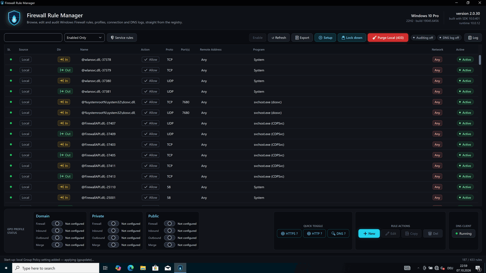
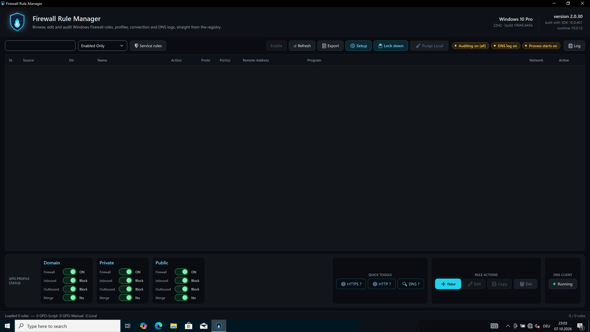

# FirewallManager

A Windows desktop tool for power users and administrators who run their machine on a **deny-by-default** firewall posture and want repeatable, auditable, and reversible control over Windows Firewall state.

FirewallManager writes firewall rules and profile policy **directly into the Group Policy key in the registry** instead of going through `netsh` or the MMC snap-in, then has Windows apply them and checks that it did. It surfaces the full rule set in one place — the policy rules and Windows' own local rules — tells you where each rule came from, lets you edit or toggle your own, and pairs the whole thing with a connection log that names the program behind each connection and separates real traffic from background noise.

A firewall with hundreds of rules, there so that nothing ever breaks, isn't worth the name — it risks becoming security theatre. A fresh, offline install of Windows 10 Pro 22H2 already ships with 433 of them, 187 switched on. FirewallManager aims for a legible setup: the few rules you made on purpose, each one readable. It doesn't keep asking "are you sure?". You can do the wrong thing with it, which is the point: it is built for people who know how a firewall works.

> **This is a power tool.** It modifies the same registry locations that govern your machine's network security. A wrong rule can lock you out of the network or expose a service you meant to keep closed. It is built for people who already understand Windows Firewall and want a faster, more legible way to drive it.



---

## Features

### Rule browser & editor
- Lists every firewall rule from both the **GPO policy store** (`SOFTWARE\Policies\Microsoft\WindowsFirewall\FirewallRules`) and the **local store** (`SYSTEM\...\SharedAccess\Parameters\FirewallPolicy\FirewallRules`).
- Each rule shows direction, action, protocol, ports, its remote addresses (IPv4 and IPv6 in separate columns, never merged), program (with an icon in front, see below), active state, a **Network** tag (Local, Remote, Mixed, Any; judged on the IPv4 addresses), and **source** — so you can tell a script-managed rule from a manually-created GPO rule from a local rule at a glance. Windows' own rule names, stored as references such as `@FirewallAPI.dll,-28775`, show as readable text in Windows' display language; the reference stays in the tooltip, backups and exports. Hidden characters in a name or program path (zero-width, direction controls, spaces other than the plain one) show as ⟨ZWSP U+200B⟩, and a word mixing Latin with Cyrillic or Greek letters is flagged: the cell gets a ⚠ and the tooltip says what was found. Search finds the stored text as well; backups and exports keep it unchanged. The header shows whether IPv4 and IPv6 are on; with IPv6 off, the IPv6 column is hidden.
- **Rule names**: every rule made here is stored with CUSTOM in front, twice over: in its registry value name (`CUSTOM_Firefox_Out`, by which the app knows its own rules) and in its name (`CUSTOM Firefox Out`, which is what Windows' own tools, wf.msc, gpedit and `netsh`, show). So outside the app it's plain where a rule came from. The app shows the name without it, and the editor adds it on save. A rule of the app's whose name lacks it (made by an early version) gets a ⚠ in the Name column; edit and save to add it. Nothing renames a rule on its own.
- **Program icons**: in front of each program, the icon Explorer shows for it, so an app's rules are found by eye; two copies of one app (say an installed and a portable Firefox) show as the same icon twice. A rule for one service inside `svchost.exe` gets a Windows icon that stands for it: Remote Desktop Connection for TermService, a globe for Dnscache, a clock globe for W32Time, and the Services console's gear for any other. On a Windows trimmed of those files (NTLite and the like) the app draws its own instead, the same ones its Setup tiles and Setup button use. A program that isn't there gets an amber **alert**: the rule still allows whatever is put at that path later. A program that can't be checked (a network path, which can stall when the share is out of reach, or a file Windows won't let the app look at) gets the app's plain program icon, and its tooltip says why. A rule tied to a service the firewall can't tell apart gets the same alert: one with no service identity of its own (its SID type is none), or one that isn't installed. Such a rule never matches, so it does nothing; the tooltip says which. A program given by name only, or by a relative path, gets the alert too: a rule matches a program by its full path, so it never matches. A Store app whose exe is gone was most likely updated; its tooltip says that Edit → Update finds the new folder. System and rules without a program show none. Icons are looked up once and kept; **Refresh** looks again.
- Create, edit, copy, enable/disable, and delete rules. GPO-Manual rules and Windows' local rules open **read-only** to avoid clobbering policy you didn't author here; a local rule can still be copied into a rule of your own, or deleted (through the firewall, after a `.reg` backup of that rule; like **Purge Local**, only with merge off on all three profiles). A rule with settings the editor doesn't offer (a profile limit, IPv6 addresses, specific ICMP message types and the like) opens read-only and isn't copied, with a note naming those settings, so nothing is silently dropped (a description or group alone doesn't stop a copy). The protocol is TCP, UDP, ICMP, ICMPv6 or Any; an ICMP or ICMPv6 rule covers every message type and has no ports. ICMPv6 never carries an IPv4 address, so an ICMPv6 rule with the address limit on or a local address isn't saved. New rules start with direction, action and protocol empty: choose them, or use a preset. They also start with the remote-address limit on and no address in it: add addresses, or switch the limit off, which is how any address is chosen. Addresses and ports are checked only for whether they can exist (IPv4 octets 0–255, ports 1–65535; /0 is refused because Windows won't load it), and hovering a subnet or range shows its exact span. A character a field can't hold is taken out where it was, named under the field, and plain alternatives are offered (ü → u or ue, ’ → '); nothing is changed silently. What each field accepts, and why:

  | Field | Accepts | Why |
  |---|---|---|
  | Name | Printable ASCII (space to `~`), except `\|` and `_` | `\|` separates the fields of a rule; `_` stands for a space in the rule's registry name |
  | Addresses | IPv4 address, range `a-b`, subnet `a/n` or `a/mask`, comma-separated | Only what can exist; `/0` is refused because Windows won't load it |
  | Ports | 1–65535 and ranges `a-b`, comma-separated | Only what can exist |
  | Program | The path as the file system has it | It is the file's real name |

- **Purge Local** removes all of Windows' local rules in one go, through the firewall itself so they are gone at once, after saving them as a `.reg` backup. It works only with local merge off on all three profiles: then they don't apply anyway and are only noise. While merge is on (or not configured, which Windows treats as on) in any profile, they are in use, and the button is off; its tooltip names the profiles. Programs keep writing rules of their own as they install and update, so the clutter comes back and you'll purge more than once. That's why the button isn't guarded otherwise: one click immediately disposes of the noise.
- **Program colours**: the program's name says what the file is, checked by Windows (its signature, or Windows' own catalog, offline: whether a certificate was revoked isn't asked). They state what a signature proves and nothing more; whom to trust stays yours.

  | Colour | The file |
  |---|---|
  | dark green | Windows' own, unchanged since Microsoft signed it |
  | light green | signed by its maker and unchanged since, or matching your pin |
  | indigo | not signed (your own tools, most small utilities): different, not wrong |
  | amber | an off case: a signature that doesn't hold, or a look-alike (below) |
  | red | changed since you pinned it |

  Read in that order, the colours are a review order: amber and red first, then indigo and light green, dark green last. The tooltip names the signer, or what doesn't hold. The same colours show in the rule editor, the connection log's Program column and Talkers.
- **Look-alikes**: a name one letter off a program malware likes to imitate (`scvhost.exe`, `svch0st.exe`; two letters for names of eight or more), or the right name in the wrong place or with the wrong signer (a `svchost.exe` outside System32, or not signed by Microsoft Windows; a `firefox.exe` not signed by Mozilla), is amber. The list: svchost, lsass, csrss, services, winlogon, smss, spoolsv, taskhostw, rundll32, dllhost, mstsc, conhost, wininit, explorer, and, by signer only, firefox, chrome and msedge. Windows' own files are never taken for a look-alike. Shown, never blocked.
- **Pins**: **Pin** in the rule editor records a program file by its exact content (SHA-256): approval by the file itself, with no certificate authority in it, which suits programs nobody signs. A matching pin is light green, one that no longer matches red until you pin the file again. Pins are kept in `FirewallManager.json` next to the exe, so they travel with the app; in a read-only folder (Program Files) pinning isn't available. A pinned program carries a small fingerprint after its name: light grey at rest, green once its file was hashed and matched in this session, red when it changed. At start only size and date are compared, and a file where either changed is hashed in the background, as is any pin last fully checked more than 30 days ago. The fingerprint button in the Program column's header hashes them all now, one after another in plain view (each mark amber while its file is hashed; rules for the same file change together). The button itself is amber until every pin was checked in this session, then green, or red while one doesn't match.
- The rule editor has presets (SMB, RDP, Browser, DNS, Time, IIS), a program browser, a service picker that limits an `svchost.exe` rule to one service, and a local-address field. Under Program: **Service** fills in `svchost.exe` and opens the list of services; **Store app…** lists the installed Store apps a rule by path can match (desktop apps packaged for the Store; sandboxed ones such as Calculator are matched by Windows by their package, so they aren't offered) and fills in the exe; **Update** finds a program again after an update moved it. A program must be `System`, empty (any program) or a full path; a bare name like `svchost.exe` is refused, since it never matches. A Store app's folder changes with every update, and the editor says so for those.
  - **DNS**: UDP 53 to one resolver, for the DNS Client service only. One resolver, so every answer has one known source. Add TCP 53 only once the log shows it is needed.
  - **Time**: UDP 123 to one time server (your gateway, or another you type), for the Windows Time service (W32Time) only. Where W32Time has no service identity of its own, or isn't installed, the rule can't be tied to it: the program stays empty, so any program may use it, and the editor says why.
  - **IIS**: inbound HTTPS (TCP 443) to this server's own address, from the hosts you name — nothing blanket is prefilled. IIS is served by the kernel's HTTP listener, which runs as System, so the rule can't name IIS itself: anything else served on 443 passes too.
- Quick switches for blanket **HTTPS** and **HTTP** out (for short debugging sessions, and installs that unpack into a fresh temporary folder each run, where no rule per program can hold) and the **DNS** rule. A missing rule is created switched off unless you choose otherwise.
- Search and filter (enabled only, disabled only, block only, by direction, by source, and so on).
- Export the current rule list to a plain-text report.

- **Updates**: Store apps update themselves through Windows' Store services. On a deny-by-default machine those are blocked like everything else, so a Store app doesn't update until you let that happen deliberately. The same holds for Windows itself: the deny-by-default way is to fetch updates deliberately, such as the `.msu` packages from Microsoft's Update Catalog ([catalog.update.microsoft.com](https://www.catalog.update.microsoft.com)), and install them offline. Where an app also comes as a regular installer, that version fits this way of working better than its Store version. If the last cumulative update is a while back, the Windows name in the header shows it. For convenience, open the app and wait 30 seconds…

### Profile status & toggles
- Per-profile view of `EnableFirewall`, `DefaultInboundAction`, `DefaultOutboundAction`, and local merge (whether Windows' local rules count).
- Each setting is a switch with the safe state (firewall on, inbound block, outbound block, merge off) clearly marked. Moving a switch to the unsafe side asks first.
- **Merge banner:** while merge is on or not configured in any profile, a banner above the rules says so: Windows' local rules count there, and programs add their own as they install.
- **Guarded over Remote Desktop:** a Remote Desktop session survives while its profile has the firewall off, inbound Allow, or merge on (which keeps Windows' own Remote Desktop rule). **Merge → No**, **Inbound → Block** and **Firewall → ON** (here, in Setup, and the start-up move below) stop first when the result would be firewall on, inbound blocked and merge off, you are in a remote session, and a client connected over the network isn't let in by a rule created in this app (rules from outside the app, such as gpedit's, aren't judged). Then the app offers to write the rule and runs with the same failsafe as Lock down (state saved, reconnect, **Keep** within 180 seconds, or it is put back). Refusing the rule takes a second, deliberately different screen that states the facts and makes you say that you can reach the machine directly; then the change goes through without a rule and without a failsafe. A session through a tunnel (a connection to the Remote Desktop port from this machine itself, as with `ssh -L`) goes straight to that screen, since no rule can be written for it. At the console, or in a Hyper-V enhanced session, nothing is asked.
- **Outgoing carriers:** if your Remote Desktop connection comes in over a VPN or tunnel adapter (WireGuard, Tailscale, a Windows VPN connection and the like), a change that leaves outbound blocked (**Outbound → Block**, **Firewall → ON**, **Merge → No**, Lock down) goes to the same last-chance screen first: the program carrying that connection goes out, and nothing tells the app which program it is. Plain Remote Desktop isn't affected by outbound block.
- **Your own way in:** switching off, deleting or editing the rule created in this app that lets your current Remote Desktop client in (with the firewall on, inbound blocked and merge off) goes to the last-chance screen with **THAT IS FINE I AM DONE HERE AND CUT MYSELF OUT PROCEED**. Locking yourself out when you're done is legitimate; it asks once.
- When the app finds no screen, keyboard or mouse attached to the machine, the last-chance screen says so.
- **Profiles:** the app treats Domain, Private and Public alike, and so should you. Which one is in force is Windows' call, it can change without notice, and a rule that holds on only one of them fails the moment Windows picks another. If a machine really must behave differently on different networks, the tool for that is IPsec with certificates. A connection proves who it comes from, instead of the firewall guessing from a network's label. That is outside this app for now. The assumption behind this: you don't use a profile to decide whether something like Remote Desktop is open, open on Private and closed on Public. On a machine that moves between networks, such as a laptop, Remote Desktop stays closed everywhere and is opened deliberately, only when it's needed. The app takes the friction out of that: switching a rule on or off is one click here, so the effort that once made leaving it open the easier choice is gone.
- A **DNS Client** button sets the DNS Client service to Disabled (after a `.reg` backup) or back to Automatic; it takes effect after a restart.
- After every change the app runs `gpupdate`, then compares what the firewall actually applies with the policy key, and says **in force** or lists what differs. If gpupdate reports an error, the comparison still runs and the status line says both: on a domain machine with outbound blocked, gpupdate can't reach the domain and still applies the local policy. The status line shows it in colour: amber while applying, green once in force, red for a problem.

### Lock down
One click takes a fresh machine to a safe state: firewall on, inbound and outbound blocked on all profiles, local merge off, Windows' local rules removed through the firewall once the lock-down is in force (until then they stay, and the status line says so), and recording switched on. Existing policy rules stay. The state before is saved as a `.reg` file plus the firewall's own export (`.wfw`), and putting it back takes effect at once; on a machine that already has policy, it asks first.

Over Remote Desktop it writes a rule for each connected client before the block (naming a rule it replaces), then asks you to reconnect and click **Keep** within 180 seconds — otherwise it puts the firewall back. A one-time scheduled task does the same after 360 seconds, should the app be gone. Each client's rule covers the port(s) it is connected on. In a remote session with no network client, a tunnel (a connection to the Remote Desktop port from this machine itself) is named in the question, and going on without failsafe takes the last-chance screen. If Windows refuses the rule, the firewall is put back at once; if the change isn't in force yet, the countdown says a reconnect may not test it. At the console no rule is written for other people's Remote Desktop sessions: the confirmation says they end. Lock down won't start while a failsafe task from earlier is still armed, and the app can't be closed while Lock down or Purge Local runs.

At the machine's own screen nothing on the network can be cut off, so there is no countdown. A remote session without a connection on the RDP port (a Hyper-V enhanced session, RDP through a gateway or another port) asks whether to use the failsafe. If the machine's connections can't be read, Lock down refuses. On a domain-joined machine it always asks first: with outbound blocked, policy refreshes and the restore may only take effect after a restart.

**Defender while locked down**: a consequence of the lockdown is that Microsoft Defender can no longer reach its cloud: it waits for answers that never come, and every new file is held up for nothing. With all three profiles locked down (firewall on, inbound and outbound blocked, no merge), the Defender box next to them can turn off cloud lookups, sample sending and block at first sight, and stop scanning fixed drives other than the system drive (usually C:), since new files usually arrive there. Removable and network drives are always scanned. Sample sending and block at first sight work only with cloud lookups: while those are off, they show as inactive. The box shows what Defender reports in force, read back after every change. A switch whose value the local Group Policy (gpedit) sets is greyed out, and its tooltip names the setting to change there. If any of this is still off after the lockdown is lifted, the box and the affected switches turn red: the app doesn't stop you, but you see what you're doing. Without Defender (removed, for example with NTLite), the box says so.



From there, you can allow one browser's binary, `browser.exe`, to one IP address over TCP 443: that address is reachable, and nothing else goes anywhere. This works (tested) as long as you reach the web server by its IP address; reaching it by name needs DNS allowed in some form or a local hosts file.

**To the extreme.** Lock down, switch the DNS Client off (the button, then a restart), and add one rule: `firefox.exe`, out, TCP 80 and 443. Windows itself can no longer resolve any name: programs that ask it get "no such host" before a packet is sent. Firefox resolves names itself, over HTTPS, with three settings in `about:config`:

| Preference | Value |
|---|---|
| `network.trr.mode` | `3` (Firefox's own DNS only, never Windows) |
| `network.trr.uri` | `https://dns.quad9.net/dns-query` |
| `network.trr.bootstrapAddr` | `9.9.9.9` (reaches the resolver without a name lookup) |

Firefox has the internet; nothing else on the machine reaches the network. The log flags Firefox's lookups as encrypted DNS: here, that's the setup working.

Tested on Windows 11 Pro 26H2 (build 26300.9457) with Firefox Developer Edition 158.0b5, portable.

**NOTE:** This works technically. Whether it's advisable is up to you: among the consequences are no Windows Update, no Defender definition updates and no SmartScreen. Here it was an experiment in how far it can go.

### Setup wizard
Tiles for the rules a locked-down box usually needs: Remote Desktop and file sharing to and from machines on your network, time sync, your browsers, and services such as GitHub, Claude and NuGet. Remote Desktop in uses the port this machine is set to listen on; for Claude you pick either Anthropic's published address range (with the date it was looked up) or one address from a fresh lookup, and a lookup that fails says which name and why. If local merge is still on, creating a rule asks once whether to turn it off, so only the rules you made count; over Remote Desktop, turning it off is guarded (see Profile status & toggles). Time sync writes the same rule as the editor's Time preset: for the Windows Time service only where it can be tied to it, else for any program, and the tile says which. If the port this machine is set to can't be read, the tile says 3389 is assumed; if the setting differs from the port Remote Desktop still listens on (a change waits for the service to restart), the tile says so.

Creating the Remote Desktop rule while you are connected over Remote Desktop runs with the same failsafe as Lock down: the state is saved first (`.reg` + `.wfw`), a one-time scheduled task is armed, the rule is written, and you reconnect and click **Keep** within 180 seconds, or the firewall is put back. Setup won't replace a failsafe task that is still armed from earlier.

### Start-up checks
Two things would make the app show settings Windows doesn't apply: a local Group Policy with no firewall setting (so the firewall never re-reads the policy key until a restart), and values left under the pre-Vista `StandardProfile` key. Each is explained before anything is changed; **AGREE** fixes it, **CLOSE APP** exits with nothing changed. If moving the `StandardProfile` values would cut a Remote Desktop session you are in, nothing is written yet: the main window opens locked and the same guard as for merge off asks first, with **CLOSE APP: NOTHING IS WRITTEN, NOT EVEN WHAT I AGREED TO** in place of Cancel.

Only one copy of the app runs per machine, since every copy changes the same machine-wide policy: starting it again brings the open window to the front.

The Windows tools the app starts (gpupdate, PowerShell, reg, schtasks and others) are run by their full path in System32, never by bare name. If one needed for changes is missing, as on a trimmed Windows image, the app names it and offers one button: **CLOSE APP**. Without it a change would be written but not applied, not checked, or not undoable. A missing tool that only one feature needs stops just that feature, which says why when used; Lock down needs netsh for its export and refuses without it.

### Connection log
- **Live** reads Windows' Security log: blocked and, if switched on, allowed connections, with the program behind each and, for service hosts, the service, named from process-start events even when the program has already ended. Right-click **Who owns this connection?** shows the process holding a live TCP connection. **File** reads `pfirewall.log`, which has no program names. The log is read once and then follows new connections as they arrive (in Live by default; in File when **Follow** is on, as Windows writes the file, which it does late); filters apply to what has been read without reading it again, and **Refresh** reads everything afresh.
- **Noise suppression**: multicast (224–239, ff00::/8), broadcast (255.255.255.255 and this machine's own network broadcast; any other address ending in .255 is a host and shows), link-local (169.254.x, fe80::/10), NetBIOS, mDNS, SSDP/WSD, LLMNR, loopback (127.x, ::1), and DNS that your switched-on rules allow are filtered out by default so the log starts clean. Two switches, **IPv4** and **IPv6**, say for which family the categories hide anything; a family that is off on this machine is dimmed.
- **DNS tripwire**: outgoing DNS that **none** of your switched-on rules allows is flagged rather than hidden — dropped in amber, allowed (it went out) in red — which is exactly what you want to notice on a deny-by-default machine. The DNS servers in Windows' network settings aren't firewall rules, so until a DNS rule of the app is on, every DNS query is flagged, and a banner above the log says so (naming DNS rules made in gpedit, which don't count). Encrypted DNS is flagged too. DNS a program sends itself through a rule of yours that doesn't name it is a note, not an alarm: it never reaches Windows' DNS log. DNS to this machine's own loopback isn't flagged: it never leaves the machine.
- **Filter**: in Live, each connection names the Windows filter that decided it. Windows renumbers its filters whenever the firewall reloads its rules; the log marks those moments, so a filter ID only means the same filter between two marks. Windows also renumbers them, without any event, at some network changes (seen when a machine comes onto its network); the log shows network connected/disconnected lines as context (collapsed when the network flaps) and clock changes over a minute, and an ID that no longer exists says so.
- **Rule inference**: the viewer names the rule that allowed a connection, and distinguishes it from a *disabled* rule that would have allowed it.
- **Names**: each address is named from the DNS lookup that returned it, from Windows' DNS client log; failing that, it is tagged by known address ranges (GitHub, Cloudflare, Fastly, Microsoft, etc.).
- **Talkers** ranks programs by blocked attempts, with **Allow…** to make a rule from what was seen. **Lookups** lists every DNS name asked for, by whom, with flags for names that look like smuggled data. A program or answer that reaches both local and remote addresses is tagged **Mixed** in the outlier colour, with the counts on hover: something that talks to both is worth a look.
- Program paths show as the disk spells them (Windows logs them in lowercase); a path that no longer exists stays as logged.
- **Copy for AI** puts the view on the clipboard as readable text, to paste into an AI chat.
- Recording (auditing, the DNS log, process starts, the text log) changes Windows settings and keeps going after the app closes. The main window shows what is on, and closing the app asks whether to keep it.

### Service hardening
Windows keeps a second set of rules for its own services, apart from your policy and the local rules, and in many cases they are overlooked. It comes in two stores: **Static**, shipped with Windows, and **Configurable**, which services and their installers add to over time. Merge off and Lock down don't touch either.

**Service rules** shows them. Each rule shows its program, marked when the file is gone, and who may run that file. They restrict Windows' services: a service gets through only where they and your rules both allow it, so a normal permit there opens nothing your rules block. The one exception would be a *hard* permit outranking your rules in a layer where they decide, and the **Hard** column checks for one. None has turned up in normal use on any machine tested here so far (the verdicts were checked against test filters); a managed IoT device, where a maintenance channel must never be blocked by accident, is the kind of place where one would earn its keep.

**Purge obsolete** removes Configurable rules whose program file is no longer on the computer. What gets removed is backed up. Nothing else there can be removed or switched off, on purpose: a block only takes away, a normal permit opens nothing your rules block, and what removing either does is untested.

### Configuration that survives editing
All of the app's "knowledge" — noise predicates, DNS presets, service address ranges, org tags, and known encrypted-DNS servers — lives in an external `config.json` next to the executable. See [Configuration](#configuration) below.

### One-time consent gate
On first launch the app requires you to acknowledge what it does and accept responsibility before it will open. The acknowledgment is stored per-user and can be reviewed later by clicking the logo.

---

## Before you build or run it

- **Needs administrator rights:** runs as administrator; Windows asks when it starts.
- **Changes security settings:** changes Windows Firewall, audit policy and Microsoft Defender settings.
- **Starts on its own:** creates a scheduled task.
- **Starts other programs:** sc, ipconfig, gpupdate, powershell, netsh, auditpol, reg and schtasks.
- **Changes the whole computer:** writes the registry under HKLM and files on the system drive.
- **Talks to other computers:** connects to claude.ai, api.anthropic.com and api.nuget.org.

## Requirements

- **Windows 10 or 11, or Windows Server 2019** (tested: build 17763.3650), x64.
- **.NET 10 SDK** to build. Builds are self-contained, so running needs no .NET install.
- **Administrator privileges.** The app manifest requests elevation (`requireAdministrator`) because it reads and writes machine-level firewall policy. It will prompt for elevation on launch.

---

## Building

```powershell
# from the folder with FirewallManager.csproj
dotnet publish -c Release
```

The exe lands in `bin\Release\net10.0-windows\win-x64\publish\`. Single-file and self-contained are set in the project file, so no extra switches are needed. The project uses WPF, is x64-only, and has no external NuGet dependencies. `Assets/app.ico` and `Assets/app_256.png` must be present before building.

The header shows the app version, the .NET SDK that built the exe and the runtime packed into it, so any copy can be traced to its build.

### With RepoBuilder

[RepoBuilder](https://github.com/sascha-codeforfun/RepoBuilder) is the companion build tool: it turns a repo folder or zip into one self-contained exe, offline, and files the exact source next to every binary. Its log records the full `dotnet publish` command. Builds are deterministic, so the same source, SDK and runtime packs give the same bytes, and any copy can be checked by rebuilding it and comparing hashes.

There is no installer: put `FirewallManager.exe` where you want it and run it.

---

## Configuration

`FirewallManager` looks for a `config.json` file **next to the executable**. This file is optional.

- **Present and valid** → the app offers its values the next time you open Setup (see below). Until you have chosen, and again whenever the file changes, the built-in values are used.
- **Missing** → the app runs on a compiled-in baseline (a complete, working default).
- **Corrupt or unparseable** → the app says so at start, with the error's position, and offers to use the baseline for the session or close.

The config holds five sections:

| Section        | What it controls                                                        |
|----------------|-------------------------------------------------------------------------|
| `noise`        | Predicates for which log traffic counts as background noise.            |
| `dnsPresets`   | The resolvers offered by the rule editor's DNS preset.                  |
| `services`     | Named address ranges for Setup (GitHub).                                |
| `orgTags`      | Address-prefix → label mappings for tagging log entries.                |
| `encryptedDns` | Known DNS-over-HTTPS/TLS servers, flagged in the log.                   |

### Why your edits don't get falsely flagged

Config loading is deliberately tolerant of *how the file is stored* and strict only about *what it means*. The app parses `config.json` into a typed model and hashes a **canonical** serialization of that model. That means CRLF vs LF, a UTF-8 BOM, trailing whitespace, indentation, and key order **never** change the hash — only a real change to a value does.

When your `config.json` differs from the baseline, the app surfaces the differences **per section** the next time you open Setup and lets you choose, section by section, whether to use your file's values or the built-in defaults. This prompt is hash-gated, so an unchanged config never nags you again. Values that can't represent a real address (bad IPv4 octets, out-of-range CIDR prefixes) are rejected as *impossible* — distinct from values that are merely risky, which remain your call.

You can export the current baseline as an editable starting template from Setup.

---

## What it changes on Windows

Machine-wide, all made visible in the app:
- **Firewall policy:** rules and profile values under `HKLM\SOFTWARE\Policies\Microsoft\WindowsFirewall`; Windows' local rules only when you delete or purge them (or lock down).
- **Service-hardening rules:** only obsolete ones, when you use **Purge obsolete**.
- **Scheduled task:** only during a lock-down over Remote Desktop, while Setup creates the Remote Desktop rule over Remote Desktop, or while a guarded change (merge off, inbound block, firewall on, the start-up move) goes through with a Remote Desktop rule: the one-time failsafe.
- **Local Group Policy:** one log-size setting, at the size it already has (see Start-up checks).
- **Audit policy:** *Filtering Platform Connection* and *Process Creation*, plus the policy value that adds command lines to process starts.
- **DNS Client log**, and the **firewall text log**, switched on or off.
- **DNS Client service:** its start type, when you use the DNS Client button.
- **Remote Desktop:** switched on with Network Level Authentication, when you ask for it in Setup.
- **Microsoft Defender policy:** only from the Defender box while locked down: `SpynetReporting`, `SubmitSamplesConsent` and `DisableBlockAtFirstSeen` under `HKLM\SOFTWARE\Policies\Microsoft\Windows Defender\Spynet`, and whole internal drives as path exclusions under `…\Windows Defender\Exclusions\Paths`. Switching back deletes them; exclusions you set in Windows Security yourself are never touched.

### Files: `C:\FirewallManager`
Every file the app writes on its own goes to this one folder: the `.reg` backups made before **Purge Local**, deleting one local rule, **Purge obsolete**, the **DNS Client** button, **Lock down**, Setup's Remote Desktop rule over Remote Desktop (`before-rdp-rule-…`), and a guarded change with a Remote Desktop rule (`before-merge-off-…`, `before-inbound-block-…`, `before-firewall-on-…`, `before-startup-move-…`). Double-click one (as administrator) to put that state back. Purge Local, Lock down and the Remote Desktop failsafes also save the firewall's own export next to their `.reg` (`.wfw`, same name): importing it (`netsh advfirewall import`, or Import Policy in Windows' firewall console) puts the local rules back at once, while a `.reg` alone brings them back only after the next restart. The app never deletes a complete backup; only when the firewall export fails is the half-written pair removed, so it can't pass for a whole one. Two short-lived files pass through as well and are deleted right after use: the lock-down failsafe's task definition, and, only when netsh doesn't take its commands directly, a script for the start-up Group Policy setting.

The folder is local, so a profile redirected to a network share can't put it out of reach when outbound is blocked. Users may read it; only Administrators and SYSTEM may change it, since the lock-down failsafe imports files from it as SYSTEM. If an existing folder has other permissions, the app refuses to use it and asks you to delete it.

Apart from those, the app writes one file of its own: `FirewallManager.json` next to the exe, holding your pins, and only once you pin something. Exports (rule list, connection log, config template) go wherever you choose.

### How it stores its own settings
App-level state — the consent acknowledgment, the config hash, and your per-section config decisions — is stored under `HKEY_CURRENT_USER\Software\GeekFirewallManager`. Nothing about the app's own preferences is written to machine-level keys. Pins are the one exception to the registry: they are kept in `FirewallManager.json` next to the exe, so copying the app's folder takes them along.

---

## Removing

Deleting the exe removes the app, not what it set on Windows — the firewall policy is meant to stay. Recording is the part to think about: it keeps going after the app closes. The app asks about it on close; if the exe is gone without that question, switch it off in an elevated command prompt (the IDs work on any Windows language):

```
auditpol /set /subcategory:{0CCE9226-69AE-11D9-BED3-505054503030} /success:disable /failure:disable
auditpol /set /subcategory:{0CCE922B-69AE-11D9-BED3-505054503030} /success:disable
wevtutil sl Microsoft-Windows-DNS-Client/Operational /e:false
```

Also delete `ProcessCreationIncludeCmdLine_Enabled` under `HKLM\SOFTWARE\Microsoft\Windows\CurrentVersion\Policies\System\Audit`. If the firewall text log was on: `netsh advfirewall set allprofiles logging droppedconnections disable`, and the same with `allowedconnections`.

Left behind by design: `C:\FirewallManager` with its backups, the three values under `HKCU\Software\GeekFirewallManager`, and the one local Group Policy setting. To remove that setting, run `netsh` and type:

```
advfirewall set store gpo=<this computer's name>
advfirewall set publicprofile logging maxfilesize notconfigured
```

---

## A note on safety

FirewallManager edits live firewall policy. A few habits worth keeping:

- **Know how you'll recover.** Have a way back in (console access, a second admin path, or a known-good rule export) before you make sweeping changes.
- **Export before large edits.** Use the rule export to capture the current state so you can compare or rebuild (set the filter to *All Rules* first).
- **Watch the source column.** Rules originating from Group Policy may be re-applied or overwritten by your domain/policy infrastructure independently of this tool.

The software is provided as-is; you are responsible for the changes you apply to your own system.

---

## License

Released under the MIT License. See [`LICENSE.txt`](LICENSE.txt).
